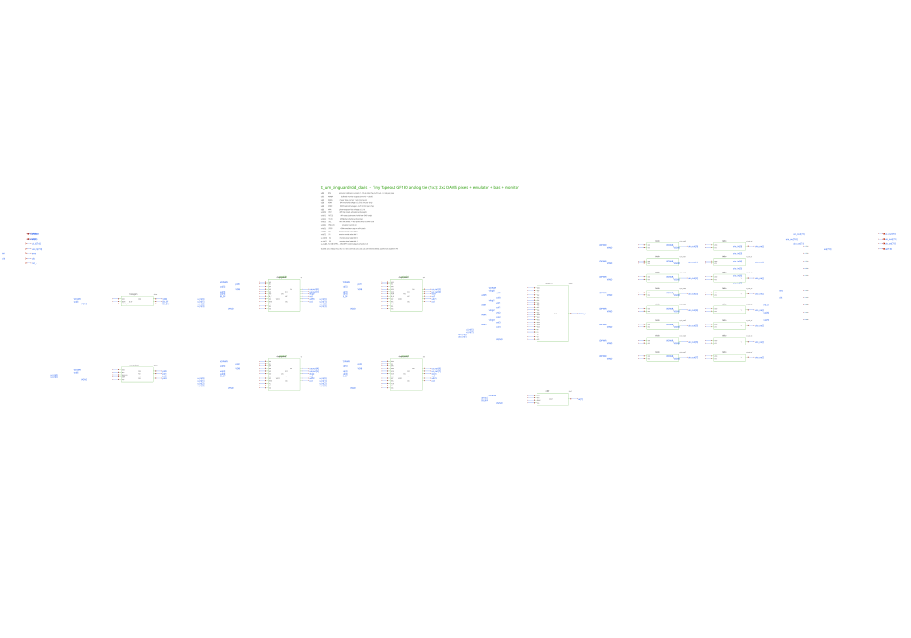
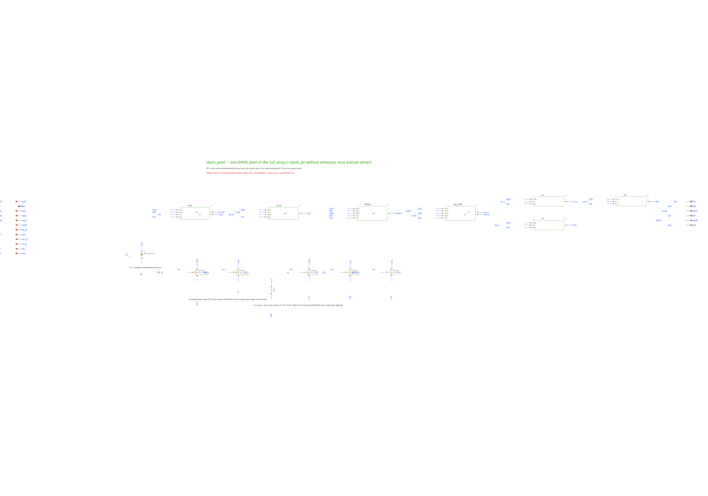
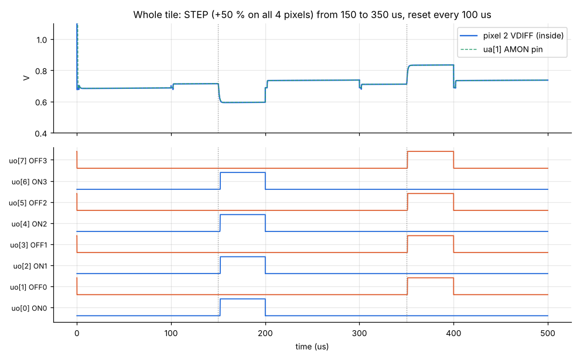

<!---

This file is used to generate your project datasheet. Please fill in the information below and delete any unused
sections.

You can also include images in this folder and reference them in the markdown. Each image must be less than
512 kb in size, and the combined size of all images must be less than 1 MB.
-->

## How it works

This tile holds four DAVIS event-camera pixels (a 2x2 array) on GF180MCU at 3.3 V, plus the circuits needed to
test them without light. It is a research and educational project that rebuilds published neuromorphic-sensor
architectures in the open. Results are simulations only; there is no guarantee that the silicon works.

An event pixel does not send frames. It sends an **ON** event when the light it sees gets brighter by a set
fraction, and an **OFF** event when it gets darker. Each pixel has:

- an 8x8 µm photodiode and a **logarithmic photoreceptor**, so the output voltage follows the log of the light;
- a **source follower** that buffers the photoreceptor;
- a switched-capacitor **differencing amplifier** (gain about −9) that remembers the level at the last reset and
  amplifies only the change since then;
- **ON/OFF comparators** that compare the change with the thresholds VON and VOFF and drive the event outputs;
- a 4T **global-shutter APS readout** (the "frame" half of DAVIS) that shares the same photodiode.

If Tiny Tapeout package is opaque, so no light reaches the die. A **photocurrent emulator** therefore feeds
each pixel a current equal to IPH/500 from the `ua[0]` pin (10 µA in gives 20 nA per pixel). The STEP input
adds +50 % to all four pixel currents, which looks to the pixels like a light step.

A **bias generator** makes the amplifier and buffer bias currents from a 1 µA master current on `ua[2]`. VON, VOFF
and VPR are pins, not on-chip voltages, because the simulations show they must be trimmed per process corner.

A **16-to-1 analog multiplexer** and an **output buffer** route one internal node of one pixel to `ua[1]` (AMON).
S1 S0 select the node and S3 S2 select the pixel.

The tile has 228 MOS transistors and draws about 54 µA. Simulated at the typical corner (VON 2.5 V, VOFF 2.25 V,
VPR 2.7 V), all four pixels give one ON event 2.1 µs after the step up and one OFF event 1.0 µs after the step
down, with no false events. Further pixel variants are under study and are not part of this tile.

## How to test

Power and bias:

1. Apply 1 µA into `ua[2]` (IBIAS) and 10 µA into `ua[0]` (IPH).
2. Set `ua[5]` (VPR) to about 2.7 V, `ua[3]` (VON) to about 2.5 V and `ua[4]` (VOFF) to about 2.25 V.
3. Hold `ui[1]` (RST_B) and `ui[2]` (TX_B) low so the APS stays in reset (event-only mode), and `ui[3]` (SEL) low.

Events:

1. Set `ui[4]` (EMU_EN) high to turn on the emulated photocurrent.
2. Pulse `ui[0]` (RST) high briefly to reset all differencing amplifiers.
3. Raise `ui[5]` (STEP). Each pixel should pulse its ON output (`uo[0]`, `uo[2]`, `uo[4]`, `uo[6]`) once.
4. Pulse RST again, then lower STEP. Each pixel should pulse its OFF output (`uo[1]`, `uo[3]`, `uo[5]`, `uo[7]`) once.
5. If events fire with no step, or not at all, trim VON and VOFF per chip. Simulated trims: fast corner 2.6 / 2.35 V,
   slow corner 2.35 / 2.10 V.

Analog monitor:

- Select a node with S1 S0 (`ui[7:6]`) and a pixel with S3 S2 (`uio[1:0]`), then measure `ua[1]` (AMON).
  The monitor tracks the selected node to within about 0.5 mV in simulation.

Frame (APS) readout:

1. Start with RST_B and TX_B low (APS in reset) and SEL high.
2. Raise RST_B to start the exposure.
3. Raise TX_B to end the exposure; the global shutter holds the value in every pixel.
4. Read the pixel column on AMON. In simulation the column goes from 2.14 V after reset to 0.22 V after a
   4 µs exposure at 20 nA.
5. Lower RST_B and TX_B again before the next event measurement, so the APS does not disturb the photoreceptor.

| Pin | Name | Function |
|---|---|---|
| `ua[0]` | IPH | emulator reference current, 1–100 µA into the pin |
| `ua[1]` | AMON | buffered analog monitor output |
| `ua[2]` | IBIAS | master bias current, 1 µA into the pin |
| `ua[3]` | VON | ON threshold voltage (~2.5 V) |
| `ua[4]` | VOFF | OFF threshold voltage (~2.25 V) |
| `ua[5]` | VPR | photoreceptor bias voltage (~2.7 V) |
| `ui[0]` | RST | differencing-amplifier reset, all pixels (active high) |
| `ui[1]` | RST_B | APS reset (active low) |
| `ui[2]` | TX_B | APS global shutter (active low) |
| `ui[3]` | SEL | APS row select |
| `ui[4]` | EMU_EN | emulator current on |
| `ui[5]` | STEP | +50 % emulator step |
| `ui[6]`, `ui[7]` | S0, S1 | monitor node select |
| `uio[0]`, `uio[1]` | S2, S3 | monitor pixel select |
| `uo[0..7]` | ON0 OFF0 … ON3 OFF3 | event outputs of pixels 0–3 |

## External hardware

- Two adjustable current sources (or a voltage source with a series resistor): 1 µA for IBIAS and 1–100 µA for IPH.
- Three adjustable voltages from 0 to 3.3 V (a DAC or potentiometers) for VON, VOFF and VPR.
- An oscilloscope or logic analyser on `uo[7:0]` for events, and a high-impedance probe on `ua[1]` for the monitor.
